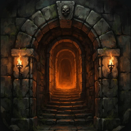

<p align="center">
  
</p>

<h1 align="center">Dungeon101</h1>

<p align="center">
  A turn-based roguelite you play in the browser: twenty-seven floors, nine bosses, six heroes, one torch.<br>
  <a href="#english">English</a> · <a href="#italiano">Italiano</a> · <a href="https://dungeon101.github.io">Play</a> · <a href="https://davide-mariotti.github.io/apps/dungeon101/">Website</a>
</p>

<p align="center">
  <a href="https://ko-fi.com/Z0X32ATNHL"></a>
</p>

---

## English

### What it does

- Twenty-seven procedurally generated floors in nine acts: the Crypt, the Fungal Caves, the Abyss, the Ember Forge, the Drowned Cathedral, the Empty Throne, the Black Cistern, the Ash Kiln and the Last Door. Every run has a different map.
- Turn-based combat on a grid. You move, everything else moves. Attacks are d20 rolls against armor, with criticals on a natural 20 (earlier for the Rogue).
- Six heroes: the **Warrior** (Cleave, Shield Bash, Charge), the **Mage** (Firebolt, Frost Nova, Blink), the **Rogue** (Shadowstep, Poison Blade, Smoke Bomb), the **Cleric** (Smite, Mend, Sanctuary), the **Paladin** (Aegis, Hammer, Consecrate) and the **Hunter** (Volley, Snare, Beast). Each has five talent branches of ten levels, with two choices on every level.
- **Specialisations**: a hero opens one branch at the start and a second one from level 10, so a run can be one deep tree or two half trees.
- Skills cost **mana** instead of a cooldown. Potions stack, a merchant turns up on some floors, and there are 15 relics that level up to five stars when you carry them to the end of a run.
- Nine bosses with their own tricks: the Bone King raises skeletons, the Broodmother webs you in place, the Ashen Lich teleports away and sets the floor on fire, and six more wait below. Their big attacks glow on the ground one turn before they land, so you can step out. Shots stop at walls and at bodies, for you and for them.
- Loot in four rarities, chests, healing fountains, sixteen kinds of consumable, elites with a purple aura. The inventory puts a found item and the one you wear on the same rows, so the difference is a number with an arrow.
- Permadeath. When you die you keep the embers you earned and spend them in the **Sanctuary** on fifty permanent upgrades, each with five levels. Each boss you kill unlocks a relic you can carry into later runs, and with the Family Vault your best item survives you.
- The run saves itself after every turn: close the tab and pick it up later.
- Works with keyboard and mouse or on a phone (tap where you want to go). English or Italian, following the browser.
- Optional Google sign-in to keep your progress in the cloud and send your runs to the Hall of Fame.

### What it doesn't do

- It doesn't need an account. Without signing in, everything stays in your browser and the game contacts Google only to show the Hall of Fame when you open it.
- It doesn't track you: no analytics, no ads, no cookies of its own.
- It doesn't publish your Google name or email. The Hall of Fame shows the hero name you choose.
- It doesn't sell anything. The embers are earned by dying, which is the only currency the dungeon accepts.
- It doesn't work offline on the first visit (it needs to load once).

### Play

Open [dungeon101.github.io](https://dungeon101.github.io). Nothing to install. On a phone you can add it to the home screen from the browser menu.

### How to use it

| | Keyboard | Touch |
|---|---|---|
| Move | WASD or arrows, diagonals with Q E Z C or the numpad | Tap a tile: the hero walks there and stops if something shows up |
| Attack | Walk into an enemy | Tap an enemy |
| Skills | 1 2 3 (same key or Enter to confirm the target, Tab to switch) | Buttons at the bottom, then tap the target |
| Potion / wait | 4 or H / Space or 5 | Buttons at the bottom |
| Descend | Enter on the stairs | The button that shows up on the stairs |
| Inventory, talents, map, pause | I, T, M, Esc | Buttons top right |

Equipping and dropping items are free; drinking a potion takes a turn. A level up gives a talent point and some health back.

### How it works

- **Rules** (`js/game.js`): plain JavaScript with no DOM, so the same code runs in Node for the tests. Every player action resolves the whole turn and returns a list of events (attack, hit, death, effect) that the renderer plays back.
- **Floors** (`js/dungeon.js`): rooms and corridors with pillars in the Crypt, cellular automata in the Caves, rooms with lava pools in the Abyss. Every floor is checked for connectivity, the stairs go to the farthest point. Field of view is recursive shadowcasting.
- **Graphics** (`js/render.js`): a single canvas. Floors are painted once per level, then every frame adds soft fog of war, torchlight with flicker, colored light from torches, crystals and lava, particles, damage numbers and screen shake. Characters are round tokens painted for this game (prompts in `docs/art/prompts/`).
- **Sound** (`js/audio.js`): every effect is synthesized with Web Audio, no audio files.
- **Saves** (`js/meta.js`): the run and the Sanctuary live in `localStorage`. After sign-in, the local and cloud copies are merged: the one that earned more embers wins, relics and records add up.
- **Cloud** (`js/cloud.js`): Firebase (project `dungeon101-dm`), loaded only when needed. `firestore.rules` lets each player read and write only their own progress, and add (never edit) their own runs to the Hall of Fame.

### Build from source

There is nothing to build. Serve the folder with any static server and open it:

```
python -m http.server 8101
```

`node tests/selftest.mjs 25` checks the floor generator, the save round trip and the progress merge, then plays 25 runs per class with a simple bot and prints how deep it gets. `node bot.mjs 20` does only the balance pass: average floor reached and what killed each class. `docs/APPUNTI.md` (in Italian) is where the work stands: what changed, how the rules fit together and what is left. Add `?debug` to the URL to reach the game state from the console (`d101.g`).

### Support

Found a bug or have an idea? Open an [issue](https://github.com/Dungeon101/Dungeon101.github.io/issues). If the game kept you up past midnight, a coffee on [Ko-fi](https://ko-fi.com/Z0X32ATNHL) is welcome.

### License

Code under the [MIT license](LICENSE). Icons from [Lucide](https://lucide.dev) (ISC). Fonts Cinzel and Geist (SIL Open Font License). The illustrations were generated with Gemini for this game.

---

## Italiano

### Cosa fa

- Ventisette piani generati a caso in nove atti: la Cripta, le Grotte Fungine, l'Abisso, la Fornace di Brace, la Cattedrale Sommersa, il Trono Vuoto, la Cisterna Nera, la Fornace di Cenere e l'Ultima Porta. Ogni partita ha una mappa diversa.
- Combattimento a turni su griglia. Ti muovi tu, si muove tutto il resto. Gli attacchi sono tiri di d20 contro l'armatura, con il critico sul 20 naturale (prima per il Ladro).
- Sei eroi: il **Guerriero** (Fendente, Colpo di scudo, Carica), la **Maga** (Dardo di fuoco, Nova di gelo, Traslazione), il **Ladro** (Passo d'ombra, Lama avvelenata, Bomba fumogena), il **Chierico** (Castigo, Cura, Santuario), il **Paladino** (Egida, Martello, Consacrazione) e il **Cacciatore** (Salva, Tagliola, Bestia). Ognuno ha cinque rami di talenti da dieci livelli, con due scelte a ogni livello.
- **Specializzazioni**: un eroe apre un ramo all'inizio e il secondo dal livello 10, così una partita può essere un albero solo portato a fondo o due alberi a metà.
- Le abilità costano **mana** invece di avere una ricarica. Le pozioni si impilano, su certi piani spunta un mercante, e ci sono 15 reliquie che salgono fino a cinque stelle se le porti a fine partita.
- Nove boss con i loro trucchi: il Re d'Ossa rialza gli scheletri, la Madre della Covata ti inchioda con la ragnatela, il Lich di Cenere si teletrasporta e dà fuoco al pavimento, e sotto ne aspettano altri sei. Gli attacchi più forti si illuminano a terra un turno prima, così fai in tempo a spostarti. I colpi si fermano sui muri e sui corpi, tuoi e loro.
- Bottino in quattro rarità, forzieri, fonti curative, sedici consumabili, nemici élite con l'aura viola. L'inventario mette l'oggetto trovato e quello indossato sulle stesse righe, così la differenza è un numero con la freccia.
- Morte permanente. Quando muori tieni le braci guadagnate e le spendi nel **Santuario** in cinquanta potenziamenti permanenti, ognuno a cinque livelli. Ogni boss ucciso sblocca una reliquia da portare nelle partite dopo, e con la Cripta di famiglia l'oggetto migliore ti sopravvive.
- La partita si salva da sola a ogni turno: chiudi la scheda e riprendi quando vuoi.
- Si gioca con tastiera e mouse o dal telefono (tocchi dove vuoi andare). In italiano o in inglese, secondo il browser.
- Accesso con Google facoltativo, per tenere i progressi nel cloud e mandare le partite all'Albo d'onore.

### Cosa non fa

- Non serve un account. Senza accesso tutto resta nel browser e il gioco contatta Google solo per mostrare l'Albo d'onore quando lo apri.
- Non ti traccia: niente statistiche, niente pubblicità, nessun cookie suo.
- Non pubblica nome ed email di Google. Nell'Albo d'onore compare il nome dell'eroe che scegli tu.
- Non vende niente. Le braci si guadagnano morendo, l'unica moneta che il dungeon accetta.
- Al primo avvio non funziona offline (deve caricarsi almeno una volta).

### Gioca

Apri [dungeon101.github.io](https://dungeon101.github.io). Niente da installare. Dal telefono puoi aggiungerlo alla schermata Home dal menu del browser.

### Come si usa

| | Tastiera | Touch |
|---|---|---|
| Muoversi | WASD o frecce, diagonali con Q E Z C o il tastierino | Tocca una casella: l'eroe ci va e si ferma se spunta qualcosa |
| Attaccare | Cammina contro un nemico | Tocca un nemico |
| Abilità | 1 2 3 (stesso tasto o Invio per confermare il bersaglio, Tab per cambiarlo) | Pulsanti in basso, poi tocca il bersaglio |
| Pozione / aspettare | 4 o H / Spazio o 5 | Pulsanti in basso |
| Scendere | Invio sulle scale | Il pulsante che compare sulle scale |
| Inventario, talenti, mappa, pausa | I, T, M, Esc | Pulsanti in alto a destra |

Equipaggiare e buttare oggetti non costa niente, bere una pozione costa un turno. Salire di livello dà un punto talento e un po' di vita.

### Come funziona

- **Regole** (`js/game.js`): JavaScript senza DOM, così lo stesso codice gira in Node per i test. Ogni azione del giocatore risolve tutto il turno e restituisce un elenco di eventi (attacco, colpo, morte, effetto) che la grafica poi mette in scena.
- **Piani** (`js/dungeon.js`): stanze e corridoi con colonne nella Cripta, automi cellulari nelle Grotte, stanze con pozze di lava nell'Abisso. Ogni piano viene controllato perché sia tutto raggiungibile, le scale stanno nel punto più lontano. Il campo visivo è shadowcasting ricorsivo.
- **Grafica** (`js/render.js`): un solo canvas. Il piano viene dipinto una volta, poi ogni fotogramma aggiunge la nebbia morbida, la torcia che tremola, la luce colorata di torce, cristalli e lava, le particelle, i numeri dei danni e gli scossoni. I personaggi sono segnalini dipinti apposta per il gioco (prompt in `docs/art/prompts/`).
- **Suoni** (`js/audio.js`): tutti sintetizzati con Web Audio, nessun file audio.
- **Salvataggi** (`js/meta.js`): la partita e il Santuario stanno in `localStorage`. Dopo l'accesso la copia locale e quella nel cloud vengono unite: vince quella che ha guadagnato più braci, reliquie e record si sommano.
- **Cloud** (`js/cloud.js`): Firebase (progetto `dungeon101-dm`), caricato solo quando serve. `firestore.rules` fa leggere e scrivere a ogni giocatore solo i suoi progressi, e aggiungere (mai modificare) le sue partite all'Albo d'onore.

### Compilare dai sorgenti

Non c'è niente da compilare. Basta servire la cartella con un server statico qualsiasi e aprirla:

```
python -m http.server 8101
```

`node tests/selftest.mjs 25` controlla il generatore dei piani, il salvataggio e l'unione dei progressi, poi gioca 25 partite per classe con un bot semplice e dice fin dove arriva. `node bot.mjs 20` fa solo il giro di bilanciamento: piano medio raggiunto e cosa ha ucciso ogni classe. In `docs/APPUNTI.md` c'è il punto del lavoro: cosa è cambiato, come stanno insieme le regole e cosa resta da fare. Con `?debug` nell'indirizzo lo stato del gioco è raggiungibile dalla console (`d101.g`).

### Supporto

Hai trovato un bug o hai un'idea? Apri una [issue](https://github.com/Dungeon101/Dungeon101.github.io/issues). Se il gioco ti ha tenuto sveglio oltre mezzanotte, un caffè su [Ko-fi](https://ko-fi.com/Z0X32ATNHL) è ben accetto.

### Licenza

Codice con [licenza MIT](LICENSE). Icone di [Lucide](https://lucide.dev) (ISC). Font Cinzel e Geist (SIL Open Font License). Le illustrazioni sono state generate con Gemini apposta per il gioco.
